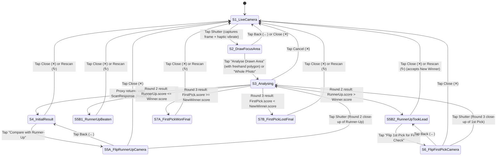

# Pomona — Produce Selection PWA Design Specification

- **Date:** 2026-10-16
- **Product Name:** Pomona (named after the Roman goddess of fruit and orchards)
- **Status:** Draft (Pending Builder Check & User Approval)
- **Visual Reference Mockups:** `.superpowers/brainstorm/34780-1792182706/content/complete-state-map-light.html` and `light-and-dark-single-cta.html`

---

## 1. Executive Summary & Intent

### 1.1 The Problem & Why
Selecting ripe, high-quality produce (watermelons, avocados, pineapples, melons, stone fruits, vegetables, etc.) is something most grocery shoppers do not know how to do reliably. Using a general-purpose AI chat app in the grocery aisle works in principle, but has two major friction points:
1. **Repetitive prompting:** Typing out what to look for every time in the store is slow and awkward.
2. **Written spatial directions:** Reading prose like *"pick the third watermelon from the left in the second row"* against a pile of nearly identical fruit is confusing and error-prone.

### 1.2 The Solution
**Pomona** is a lightweight, mobile-first Progressive Web App (PWA) that lets a shopper point their phone camera at a pile of produce or a single item, optionally trace a freehand boundary with their finger around the items within reach, and immediately see:
- A **bounding box overlay directly on the photo** highlighting the **Winner** (solid highlight-yellow box with score badge) and, when another candidate could beat it if inspected from another angle, a **Runner-Up** (dashed blue box).
- A **concise bottom sheet** with a clear verdict (`Buy it.`), a horizontal score progress bar (`8.6 / 10`), clean rectangular trait tags (`Yellow field spot`, `Matte rind`, `Even form`), and explicit consumption and storage cards (**Eat within**, **Before cut**, **After cut**).
- An **optional, user-controlled 2-to-3 step comparison flow** where the shopper can flip the Runner-Up (and, if the Runner-Up takes the lead, optionally flip their 1st Pick for a fair two-sided final check) guided by an animated 3D flipping-fruit camera overlay with produce-parameterized instructions.

---

## 2. Goals, Non-Goals & Anti-Goals

### 2.1 Goals (User-Decided)
- **Zero-prompt scanning:** Works for *any* fruit, vegetable, or produce item without the user typing prompts or pre-selecting a produce category.
- **Visual spatial clarity:** Bounding boxes drawn directly over the captured crate/pile photo identify the Winner and Runner-Up.
- **Freehand focus boundary:** After snapping a photo, the user can draw a freehand loop with their finger around the area they want analysed; the AI must strictly treat the drawn boundary as the focus area.
- **Up to 3-step head-to-head comparison with in-memory scores:** Keep Winner and Runner-Up scores and traits in memory across follow-up photos, supporting all 10 UI states across initial scan, Runner-Up flip (beaten vs. took the lead), and optional 1st Pick final flip (won vs. lost).
- **Explicit post-purchase guidance from Day 1:** Every result returns expected shelf-life (**Eat within**) and explicit **Before cut** and **After cut** storage guidance.
- **Replaceable AI model behind a strict contract:** A clean provider adapter layer on a serverless proxy backend with strict Zod schema validation, semantic guardrails/verifiers, and server-side versioned prompts so prompt/model tuning driven by evals never requires an app release.
- **Public no-account MVP under a hard \$10/month AI budget:** Anyone can open the PWA and scan without creating an account, protected by image compression/cropping, per-device/per-IP rate limits, bot protection, and a hard monthly spend circuit breaker.
- **Day-1 i18n, a11y, and o11y:** English-only strings at launch but architected for internationalisation from Day 1; WCAG 2.2 AA accessibility; product analytics and error/latency observability on a free tier.
- **Future native store packaging:** Clean client architecture ready to wrap in Capacitor (iOS App Store & Google Play) or Android Trusted Web Activity (TWA) without rewriting UI or business logic, and ready for future optional accounts (consumption reminders, saved scans).

### 2.2 Non-Goals for MVP (User-Decided)
- User accounts, login, cloud sync, or push notification reminders (deferred to a post-MVP retention phase).
- Monetisation, subscriptions, or payment processing (business model undecided; deferred post-MVP).
- Native iOS/Android store builds in the initial milestone (PWA launches first; architecture preserves drop-in Capacitor compatibility).
- Multi-language translations at launch (English copy only in MVP, though all copy flows through i18n keys and locale is passed to the backend).

### 2.3 Anti-Goals (What Would Make This a Failure Even If It Works)
- Forcing sign-up or onboarding walls before a user can scan in the aisle.
- Latency or multi-step friction that makes guessing faster than using the app ( users can always stop after Step 1's immediate winner).
- Unbounded AI spend that can exceed **\$10 USD/month**.
- Breaking the UI when an AI model hallucinates malformed JSON, out-of-bounds coordinates, or inconsistent candidate IDs.
- Hardcoding fruit-specific copy (such as `"melon"` or `"field spot"`) in the UI instead of parameterizing by the detected produce and its specific inspection criteria.

---

## 3. Complete Screen & State Machine Specification (10 States)

Pomona runs as a **single-screen mobile web application** so the camera `<video>` stream stays warm and transitions feel instantaneous. All 10 states below are required, documented, and must be covered by unit, integration, and end-to-end (E2E) tests.



### 3.1 Phase 1 — Initial Scan & First Result

#### State 1 · `S1_LiveCamera` (Live Camera Viewfinder)
- **Visuals:** Full-viewport inline `<video>` (`facingMode: { ideal: "environment" }`), top bar with `Pomona` serif brand pill, remaining daily scans pill (`8 scans left today`), and flash/torch toggle (`⚡`, shown when supported by the track, plus theme toggle). Centre target reticle with 4 highlight-yellow corner brackets. Floating prompt card above the shutter (`Point at a pile or single fruit — Works with any fruit, vegetable, or produce`). Bottom circular shutter button with highlight-yellow inner fill.
- **Interaction:** Tapping the shutter triggers `navigator.vibrate(15)` (when supported), freezes the current video frame onto an off-screen canvas, and transitions to `S2_DrawFocusArea`.

#### State 2 · `S2_DrawFocusArea` (Freehand Draw Focus Area — Optional)
- **Visuals:** Displays the captured still frame. Top bar has Back (`←`), title pill (`Draw focus area (optional)`), and Clear/Redraw (`↺`, enabled once a stroke exists). A floating pill reads `✍️ Draw around the area to focus on`.
- **Interaction (Freehand Loop, Not Drag-Box):**
  - Touch/pointer down, move, and up on the photo traces a smooth freehand closed SVG path in highlight yellow (`#f5d547`), automatically closing the start and end points when the finger lifts.
  - Using SVG `fill-rule="evenodd"`, the region **outside** the user's drawn loop is dimmed (`rgba(0,0,0,0.48)`), leaving the inside bright so the user clearly sees their focus area.
  - Tapping `↺` clears the drawn path.
  - Bottom sheet (`Step 1 · Focus area` / `Draw around your picks`) has two buttons:
    - **Whole Photo** (secondary outline): submits the full image with `focusPolygon: null`.
    - **Analyse Drawn Area** (primary forest-green, enabled when a valid polygon with area ≥ 5% of frame is drawn; if nothing is drawn, primary CTA reads **Analyse Photo**): submits the image + `focusPolygon`.

#### State 3 · `S3_Analysing` (Analysing Shimmer)
- **Visuals:** Keeps the captured frame (and the dimmed outside mask + dashed yellow loop if a focus area was drawn). An animated horizontal yellow scan beam and pulsing candidate dots play over the focus region. Status pill reads `Focusing on items in drawn area…` (or `Analysing produce…` for whole photo, or `Grading flipped {produce.displayName}…` in Rounds 2–3). Bottom sheet shows `Pomona Vision — Checking ripeness…`.
- **Interaction:** Tapping `✕` aborts the in-flight `AbortController` request and returns to `S1_LiveCamera` (or the previous result state on follow-ups).

#### State 4 · `S4_InitialResult` (Initial Result Bottom Sheet — Round 1)
- **Top Photo Viewport:**
  - Displays the original crate/pile photo with top bar (`✕` close, `{produce.displayName}` pill, `↻` rescan).
  - **Winner Bounding Box:** Solid 3px highlight-yellow border (`#f5d547`) with soft outer glow and a pill badge in the top-right corner showing the numeric score (`8.6`).
  - **Runner-Up Bounding Box (only when `followUp !== null`):** Dashed 2.5px blue border (`#2f6db5` light / `#64b5ff` dark) with a `Runner-Up` tag in the top-left corner.
- **Bottom Sheet (Full content visible, scrollable on small viewports):**
  1. **Eyebrow:** `BEST IN VIEW` (or `NO GOOD PICKS` if `verdict.winnerId === null`).
  2. **Verdict Headline:** Serif (`Fraunces`) `Buy it.` (or `Skip this batch.` when no winner).
  3. **Subtitle:** `{Confidence} confidence · {candidates.length} compared` (or `… compared in drawn area`).
  4. **Score Progress Bar:** Thin horizontal track (`7px` height, rounded) filled to `score * 10%` in highlight yellow (`#f2c935` light / `#f5d547` dark) with `8.6 / 10` in bold sans-serif on the right.
  5. **Trait Tags:** Clean rectangular chips (`6px` border-radius, no checkmarks) rendering the Winner's `signals` (e.g. `Yellow field spot`, `Matte rind`, `Even form`).
  6. **Consumption & Explicit Storage Grid (Layout B — 3 cards):**
     - Full-width top card: **`🗓 EAT WITHIN`** → e.g. `3–5 days` (or `Ready in 2–3 days · Eat within 5 days` when `readyIn.maxDays > 0`).
     - Bottom-left half card: **`🧺 BEFORE CUT`** → `{afterPurchase.storage.beforeCut.where} · {afterPurchase.storage.beforeCut.summary}` (e.g. `Counter · whole`).
     - Bottom-right half card: **`❄️ AFTER CUT`** → `{afterPurchase.storage.afterCut.where} · {afterPurchase.storage.afterCut.summary}` (e.g. `Fridge · wrapped`).
  7. **Follow-Up Banner (when `followUp !== null`):** Soft amber banner with a dashed blue square icon and `{followUp.bannerText}` (e.g. *"The blue-marked Watermelon could be sweeter. Flip it and snap."*).
  8. **Single Bottom CTA:**
     - When `followUp !== null`: a single full-width primary forest-green button: **`Compare with Runner-Up`**.
     - When `followUp === null` (single item scanned, or AI is already high-confidence with no plausible challenger): no follow-up banner is shown, and the single button reads **`Scan Another`** (which resets to `S1_LiveCamera`).

---

### 3.2 Phase 2 — Flip Runner-Up & Its Two Outcomes

#### State 5A · `S5A_FlipRunnerUpCamera` (Flip Runner-Up Camera Overlay — Round 2 Capture)
- **Visuals:**
  - Live camera stream active in the background with radial scrim.
  - Top bar: Back (`←` returns to `S4_InitialResult`), pill (`Runner-Up · Step 2`), Close (`✕` resets to `S1_LiveCamera`).
  - **Reference Thumbnail (`pipBlue`):** Top-right `68x68px` rounded thumbnail cropped from the Round 1 photo around the Runner-Up's bounding box, with a blue border and `Runner-Up` label so the shopper remembers exactly which item in the pile to pick up.
  - **Centre Reticle + Generic 3D Flip Animation:** Inside the yellow corner brackets, an CSS/SVG 3D produce silhouette continuously flips 180°/360° along the X-axis with an orbiting yellow dashed arc. This animation is **identical for all produce types**.
  - **Parameterized Instruction Card (above shutter):**
    - Eyebrow: `INSPECT RUNNER-UP`
    - Headline: `Flip the {produce.displayName} over` (parameterized by `produce.displayName`).
    - Body: `{followUp.instruction}` — dynamically generated by the AI for the specific produce type (e.g., checking the underside field spot on a watermelon, checking the stem end and skin give on an avocado, checking the base leaves and aroma/colour at the base of a pineapple). Never hardcoded to "melon" or "field spot".
    - In-Memory Score Pill: `Winner to beat: {winner.score} / 10`.

#### State 5B-1 · `S5B1_RunnerUpBeaten` (Runner-Up Was Beaten After Flip — Terminal Result)
- **Trigger Condition:** Round 2 close-up of the Runner-Up returns an updated score `runnerUpUpdated.score <= originalWinner.score` (e.g. `7.2 <= 8.6`).
- **Top Photo Viewport:** Displays the original Round 1 crate photo so the user knows which item to grab:
  - **1st Pick (`originalWinner`)** keeps the solid highlight-yellow Winner box (`8.6`).
  - **Runner-Up** is shown with a muted dashed box (`Runner-Up · 7.2`).
- **Bottom Sheet:**
  - Eyebrow: `✓ 1ST PICK WINS · BEATS RUNNER-UP (8.6 VS 7.2)`
  - Verdict Headline: `Buy your 1st pick.`
  - Subtitle: `Confirmed winner · Runner-Up fell short after flip`
  - Progress Bar: `8.6 / 10` filled in yellow, with a vertical reference tick mark at `72%` (`Runner-Up: 7.2`).
  - Trait Tags & Storage Cards: Shows the 1st Pick's traits and `Eat within` / `Before cut` / `After cut` cards.
  - Confirmation Banner (green tint): `✓ Runner-Up scored {runnerUpUpdated.score} after flip ({runnerUpUpdated.flipSummary}). Stick with your 1st pick in the yellow box.`
  - Bottom CTA: No further comparison needed (journey complete; `✕` / `↻` in top bar or optional `Scan Another` resets).

#### State 5B-2 · `S5B2_RunnerUpTookLead` (Runner-Up Took the Lead — Intermediate Result with Optional Final Check)
- **Trigger Condition:** Round 2 close-up of the Runner-Up returns an updated score `runnerUpUpdated.score > originalWinner.score` (e.g. `9.0 > 8.6`).
- **Top Photo Viewport:** Displays the original Round 1 crate photo:
  - **New Winner (former Runner-Up)** now gets the solid highlight-yellow Winner box (`9.0`).
  - **1st Pick (`originalWinner`)** is shown with a dashed yellow box labeled `1st Pick · 8.6`.
- **Bottom Sheet:**
  - Eyebrow: `★ NEW WINNER · BEATS 1ST PICK (9.0 VS 8.6)`
  - Verdict Headline: `Buy this one.`
  - Subtitle: `Runner-Up took the lead · 1 final check available`
  - Progress Bar: `9.0 / 10` filled in yellow, with a vertical reference tick mark at `86%` (`1st Pick: 8.6`).
  - Trait Tags & Storage Cards: Updated to the New Winner's traits and storage details.
  - Final Check Banner (amber tint): `1st Pick (8.6) was only graded from the top. Flip it too for a fair final check, or take this one now.`
  - **Single Bottom CTA:** Full-width primary button **`Flip 1st Pick for Final Check`** (while the user is also free to just grab the new 9.0 winner and close/leave).

---

### 3.3 Phase 3 — Final Check on 1st Pick & Its Two Outcomes

#### State 6 · `S6_FlipFirstPickCamera` (Flip 1st Pick Camera Overlay — Round 3 Capture)
- **Visuals:**
  - Same live camera + generic 3D flipping fruit animation as `S5A_FlipRunnerUpCamera`, but scoped to the **1st Pick**:
  - Top bar: Back (`←` returns to `S5B2_RunnerUpTookLead`), pill (`1st Pick · Final Check`), Close (`✕`).
  - **Reference Thumbnail (`pipWin`):** Top-right `68x68px` rounded thumbnail cropped from the Round 1 photo around the **1st Pick's** bounding box, with a yellow border and `1st Pick` label.
  - **Parameterized Instruction Card:**
    - Eyebrow: `FINAL CHECK · BEAT {newWinner.score} TO RECLAIM`
    - Headline: `Flip your 1st pick over`
    - Body: `{followUp.instruction}` (same produce-specific inspection angle, so both candidates are judged on equal footing).
    - In-Memory Score Pill: `Current leader: {newWinner.score} · 1st Pick: {originalWinner.score} (top only)`.

#### State 7A · `S7A_FirstPickWonFinal` (1st Pick Won After Final Flip — Terminal Result)
- **Trigger Condition:** Round 3 close-up of the 1st Pick returns an updated score `firstPickUpdated.score >= newWinner.score` (e.g. `9.3 >= 9.0`).
- **Top Photo Viewport:** Original Round 1 crate photo:
  - **1st Pick** reclaims the solid highlight-yellow Winner box (`9.3`).
  - **Runner-Up** is shown with a muted dashed box (`Runner-Up · 9.0`).
- **Bottom Sheet:**
  - Eyebrow: `★ FINAL VERDICT · 1ST PICK RECLAIMS THE WIN (9.3 VS 9.0)`
  - Verdict Headline: `Buy your 1st pick.`
  - Subtitle: `Both checked from both sides · Highest overall grade`
  - Progress Bar: `9.3 / 10` with reference tick at `90%` (`Runner-Up: 9.0`).
  - Trait Tags & Storage Cards: 1st Pick's updated two-sided traits and storage cards.
  - Confirmation Banner (green tint): `✓ After flipping, your 1st pick jumped from 8.6 to 9.3 and beat the Runner-Up (9.0).`

#### State 7B · `S7B_FirstPickLostFinal` (1st Pick Lost After Final Flip — Terminal Result)
- **Trigger Condition:** Round 3 close-up of the 1st Pick returns an updated score `firstPickUpdated.score < newWinner.score` (e.g. `8.4 < 9.0`).
- **Top Photo Viewport:** Original Round 1 crate photo:
  - **Former Runner-Up** retains the solid highlight-yellow Winner box (`9.0`).
  - **1st Pick** is shown with a muted dashed box (`1st Pick · 8.4`).
- **Bottom Sheet:**
  - Eyebrow: `★ FINAL VERDICT · RUNNER-UP WINS (9.0 VS 8.4)`
  - Verdict Headline: `Buy the new winner.`
  - Subtitle: `Both checked from both sides · Runner-Up confirmed best`
  - Progress Bar: `9.0 / 10` with reference tick at `84%` (`1st Pick: 8.4`).
  - Trait Tags & Storage Cards: Winner's traits and storage cards.
  - Confirmation Banner (green tint): `✓ 1st Pick scored 8.4 after flip. The former Runner-Up (9.0) is confirmed as the best pick.`

### 3.4 Non-Happy-Path & Edge States (Rendered Inside the Same Bottom Sheet)
- **`no_produce` / `unclear_photo` / `multiple_types`:** When the AI returns a non-`ok` status, the bottom sheet shows the plain-language `message` (e.g. *"Couldn't spot any produce clearly — move a bit closer or turn on the light"*), hides the score bar and storage tiles, and shows a single **`Try Again`** button returning to `S1_LiveCamera`. Note: `no_produce` and `unclear_photo` still count toward rate limits to prevent abuse, whereas `analysis_failed` (5xx/provider failure) does **not** decrement the user's daily scan counter.
- **`rate_limited` (Daily Device Limit or Monthly Budget Cap Reached):** Shows a friendly sheet explaining either that the user has used their free scans for today or that Pomona's community monthly AI budget is full until reset.

---

## 4. Visual Design System & Themes

Both **Light (`Crisp Daylight`)** and **Dark (`Deep Forest`)** themes are supported from Day 1, following `prefers-color-scheme` by default with a manual override persisted in `localStorage`.

### 4.1 Typography
- **Display / Verdict Headline (`Buy it.`, `Pomona`):** `Fraunces` (variable serif, weight 600–700, `-0.015em` tracking). Gives the subtle classical nod to Pomona while staying sharp at large sizes.
- **UI & Body Copy:** `Inter` / system-ui sans-serif (weights 500, 600, 700, 800). Tabular numerals (`font-variant-numeric: tabular-nums`) on all scores (`8.6 / 10`).

### 4.2 Design Tokens

| Token | Light · Crisp Daylight | Dark · Deep Forest | Purpose |
|---|---|---|---|
| `--surface-sheet` | `#FBFAF6` | `#111D15` | Bottom sheet & primary surface |
| `--text-primary` | `#142117` | `#F3F6F1` | Headlines, values, primary copy |
| `--text-muted` | `#6B6A65` | `#97AB9C` | Eyebrows, subtitles, card labels |
| `--accent-winner` | `#F2C935` (bar) / `#F5D547` (box) | `#F5D547` | Winner bounding box, score pill, progress bar fill |
| `--accent-runnerup` | `#2F6DB5` | `#64B5FF` | Runner-Up dashed bounding box & tags |
| `--surface-track` | `#E7E2D5` | `#223829` | Unfilled score progress bar track |
| `--surface-chip` | `#EEE9DC` (text `#1F3A2B`) | `#1C3123` (text `#D8EADC`) | Rectangular trait tags (`6px` radius, no checkmarks) |
| `--surface-card` | `#FFFFFF` (border `#E6E0D2`) | `#16281C` (border `#26412F`) | `Eat within`, `Before cut`, `After cut` cards |
| `--surface-hint-warn` | `#FFF6DB` (border `#F3E3B0`) | `#232A18` (border `#3D4722`) | Follow-up / final-check amber banner |
| `--surface-hint-ok` | `#E8F3E8` (border `#C5DEC6`) | `#183020` (border `#2B5438`) | Confirmed-winner green banner (`5B-1`, `7A`, `7B`) |
| `--cta-primary` | `#2F5D34` (text `#FFFFFF`) | `#3B7A42` (text `#FFFFFF`) | Primary full-width action button |

---

## 5. Camera, Freehand Focus & Image Compression Pipeline

To minimize token usage, upload latency, and monthly AI cost:

1. **Camera Stream (`getUserMedia`):**
   - Requests `{ video: { facingMode: { ideal: "environment" }, width: { ideal: 1920 }, height: { ideal: 1440 } }, audio: false }` played inline (`playsInline`, `muted`).
2. **Freehand Focus Polygon (`S2_DrawFocusArea`):**
   - As the user draws on the photo, pointer coordinates are simplified (Ramer–Douglas–Peucker, max ~32 vertices) and normalized to integer `0–1000` `[x, y]` coordinates relative to the captured frame.
3. **Client-Side Crop, Mask & Compression (Before Upload):**
   - **When a focus polygon is drawn:**
     1. Compute the axis-aligned bounding box of the polygon with a 10% padding margin.
     2. On an off-screen `<canvas>`, fill pixels outside the user's drawn polygon with a dark translucent mask (`rgba(0,0,0,0.65)`) and draw a thin high-contrast border along the polygon path so the vision model has both a spatial crop and an unmistakable visual boundary.
     3. Crop the canvas to that padded bounding box (recording the crop offset so returned bounding boxes map cleanly back onto the full original photo in `S4_InitialResult`).
   - **Downscaling & Encoding:**
     - Scale the longest edge to **max `768px`** (configurable via server config; default `768px` so Gemini Vision processes the image as a single 258-token tile rather than multi-tile 1024px+ grids).
     - Encode as `image/webp` at `0.75` quality (falling back to `image/jpeg` at `0.78` quality on browsers without WebP canvas export). Typical payload is **35–65 KB**.

---

## 6. AI Contract, Adapter Layer & Guardrails

### 6.1 Shared Contract (`packages/contract`)
A single Zod schema in `packages/contract` is the **sole source of truth** for:
1. TypeScript types imported by both the frontend (`apps/web`) and backend (`apps/proxy`).
2. The JSON Schema passed to each LLM provider's Structured Outputs API.
3. Runtime validation on both the proxy (before returning) and the client (on receipt).

#### Request Schema (`ScanRequestSchema`)
```ts
export const PointSchema = z.tuple([
  z.number().int().min(0).max(1000), // x (0-1000)
  z.number().int().min(0).max(1000), // y (0-1000)
]);

export const CandidateMemorySchema = z.object({
  id: z.string(),
  role: z.enum(["first_pick", "runner_up"]),
  score: z.number().min(0).max(10),
  ripeness: z.enum(["underripe", "almost_ripe", "ripe", "overripe"]),
  traits: z.array(z.string()).max(5),
  anglesInspected: z.number().int().min(1).max(2),
});

export const ScanRequestSchema = z.object({
  schemaVersion: z.literal("1.0"),
  sessionId: z.string().uuid(),
  round: z.union([z.literal(1), z.literal(2), z.literal(3)]),
  locale: z.string().default("en-GB"),
  imageBase64: z.string(), // compressed <=768px WebP/JPEG
  imageMimeType: z.enum(["image/webp", "image/jpeg"]),
  focusPolygon: z.array(PointSchema).min(3).max(40).nullable(), // normalized 0-1000 in uploaded image space
  followUpContext: z
    .object({
      produceType: z.string(),
      produceDisplayName: z.string(),
      targetCandidateId: z.string(),
      targetRole: z.enum(["runner_up", "first_pick"]),
      requestedInstruction: z.string(),
      previousWinner: CandidateMemorySchema,
      previousRunnerUp: CandidateMemorySchema,
    })
    .nullable(), // non-null on rounds 2 and 3
});
```

#### Response Schema (`ScanResponseSchema`)
```ts
export const BoundingBoxSchema = z.tuple([
  z.number().int().min(0).max(1000), // ymin
  z.number().int().min(0).max(1000), // xmin
  z.number().int().min(0).max(1000), // ymax
  z.number().int().min(0).max(1000), // xmax
]);

export const StorageStageSchema = z.object({
  where: z.enum(["counter", "fridge", "pantry", "cool_dark"]),
  whereLabel: z.string().max(24), // e.g. "Counter" / "Fridge"
  summary: z.string().max(32),    // e.g. "Counter · whole" / "Fridge · wrapped"
  tip: z.string().max(90),
});

export const ScanResponseSchema = z.object({
  schemaVersion: z.literal("1.0"),
  promptVersion: z.string(),
  modelId: z.string(),
  round: z.union([z.literal(1), z.literal(2), z.literal(3)]),
  status: z.enum([
    "ok",
    "no_produce",
    "unclear_photo",
    "multiple_types",
    "analysis_failed",
  ]),
  message: z.string().max(160).nullable(),
  produce: z
    .object({
      type: z.string(),         // normalized slug, e.g. "watermelon", "avocado"
      displayName: z.string(),  // parameterized UI name, e.g. "Watermelon", "Hass Avocado"
      variety: z.string().nullable(),
    })
    .nullable(),
  candidates: z.array(
    z.object({
      id: z.string(),           // e.g. "c1", "c2"; preserved across rounds
      box: BoundingBoxSchema,   // [ymin, xmin, ymax, xmax] 0-1000
      score: z.number().min(0).max(10), // 1 decimal place
      ripeness: z.enum(["underripe", "almost_ripe", "ripe", "overripe"]),
      traits: z.array(z.string().max(28)).min(1).max(4), // e.g. ["Yellow field spot", "Matte rind", "Even form"]
      flipSummary: z.string().max(80).nullable(), // short note on Round 2/3 close-up, e.g. "pale underside"
    })
  ),
  verdict: z
    .object({
      winnerId: z.string().nullable(),
      runnerUpId: z.string().nullable(),
      confidence: z.enum(["low", "medium", "high"]),
      headline: z.string().max(32), // e.g. "Buy it." / "Buy this one." / "Buy your 1st pick."
    })
    .nullable(),
  followUp: z
    .object({
      targetCandidateId: z.string(),
      targetRole: z.enum(["runner_up", "first_pick"]),
      bannerText: z.string().max(110),  // shown in the result sheet amber banner
      flipHeadline: z.string().max(48), // e.g. "Flip the Watermelon over"
      instruction: z.string().max(120), // produce-specific angle & trait to show next
    })
    .nullable(),
  afterPurchase: z
    .object({
      readyInDays: z.object({ min: z.number().int().min(0), max: z.number().int().min(0) }),
      eatWithinDays: z.object({ min: z.number().int().min(1), max: z.number().int().min(60) }),
      eatWithinLabel: z.string().max(28), // e.g. "3–5 days"
      storage: z.object({
        beforeCut: StorageStageSchema,
        afterCut: StorageStageSchema,
      }),
    })
    .nullable(),
});
```

### 6.2 Replaceable Model Adapter Layer (`apps/proxy/src/adapters`)
- All vision models implement a single TypeScript interface:
  ```ts
  export interface VisionProviderAdapter {
    readonly providerId: string;
    readonly modelId: string;
    analyzeProduce(input: AdapterInput, signal?: AbortSignal): Promise<AdapterRawResult>;
  }
  ```
- Uses the **Vercel AI SDK (`generateObject`)** under the hood with adapters for:
  1. **`GeminiVisionAdapter`** (Default: `gemini-2.5-flash` with `thinkingBudget: 0` for low latency and minimal output token cost; configurable to `gemini-2.5-flash-lite`).
  2. **`OpenAIVisionAdapter`** (`gpt-4o-mini`, normalizing bounding boxes to the same `0–1000` `[ymin, xmin, ymax, xmax]` convention).
- Switching the active model or traffic split is a server-side config/environment change requiring zero client code changes.

### 6.3 Guardrails & Semantic Verifier Pipeline (`apps/proxy/src/verifier`)
Every model output passes through a deterministic 2-stage verifier before leaving the proxy:
1. **Stage 1 — Syntactic Check:** `ScanResponseSchema.safeParse(raw)`.
2. **Stage 2 — Semantic Invariant Verifier:**
   - When `status === "ok"`: `produce`, `verdict`, and `afterPurchase` must be non-null, and `candidates.length >= 1`.
   - Every candidate `box` must satisfy `ymin < ymax` and `xmin < xmax`, with minimum box dimensions `>= 20` (on the 0–1000 scale).
   - **Focus Polygon Containment:** When `focusPolygon` is present in Round 1, every candidate's box centre `[(xmin+xmax)/2, (ymin+ymax)/2]` must lie inside (or within a 5% tolerance of) `focusPolygon`. Candidates outside the drawn loop are stripped by the verifier before ranking.
   - **Winner & Runner-Up Consistency:** `verdict.winnerId` must exist in `candidates` and have the highest `score`. If `verdict.runnerUpId` is non-null, it must exist in `candidates`, must not equal `winnerId`, and `followUp` must be non-null on Round 1.
   - **Round-Specific Rules:**
     - Round 2 (`targetRole === "runner_up"`): updates the Runner-Up's score and compares it against `previousWinner.score`. If `runnerUp.score > previousWinner.score`, `winnerId` becomes the Runner-Up and `followUp` offers `targetRole: "first_pick"`; if `runnerUp.score <= previousWinner.score`, `winnerId` stays `previousWinner.id` and `followUp` is `null`.
     - Round 3 (`targetRole === "first_pick"`): updates the 1st Pick's score, resolves the final `winnerId`, and forces `followUp: null` (hard 3-round ceiling).
   - **Shelf-Life Sanity:** `readyInDays.min <= readyInDays.max` and `eatWithinDays.min <= eatWithinDays.max`.
   - **Parameterized Copy Check:** Rejects any `followUp` whose text mentions a different produce type than `produce.displayName`.
3. **Self-Repair / Fallback:** If Stage 1 or Stage 2 fails, the proxy performs **at most 1 automatic repair retry** (feeding the specific validation error string back to the model). If the retry still fails, the proxy returns a clean, contract-valid `status: "analysis_failed"` response and logs a verification failure event.

---

## 7. Proxy Backend, Secret Storage, Budget Controls & Automated CLI Provisioning

### 7.1 Serverless Edge Stack (`apps/proxy`)
Pomona uses **Cloudflare Workers** so both the static React PWA (`/*`) and the API proxy (`/api/v1/*`) are served from a single origin with 0ms cold starts and \$0/month hosting on the Cloudflare Free Tier:

| Layer | Technology | Purpose |
|---|---|---|
| **Edge Runtime & Emulator** | **Cloudflare Workers** + **Wrangler v4** (`Miniflare`) | Runs 100% locally via `pnpm dev` (no Cloudflare account required for local dev/testing) and deploys globally via `wrangler deploy`. |
| **HTTP Router & Middleware** | **Hono** (~14 KB) | Type-safe routes (`POST /api/v1/scan`, `GET /api/v1/quota`), payload size cap (`<= 500 KB`), Turnstile verification, and structured request logging. |
| **LLM SDK & Gateway** | **Vercel AI SDK Core (`ai`)** + `@ai-sdk/google` & `@ai-sdk/openai` via **Cloudflare AI Gateway** | Unified `generateObject()` structured output calls routed through Cloudflare AI Gateway for free request logging, rate limiting, and cost caps. |
| **Quota & Config Store** | **Cloudflare KV** (`POMONA_QUOTA_KV`) | Stores daily device/IP counters (24h TTL), monthly spend counter (`spend:YYYY-MM`), and dynamic prompt/model configuration overrides. |
| **Bot & Device Auth** | **Cloudflare Turnstile** + HMAC-Signed Token | Invisible Turnstile check on session start; Worker issues an HMAC-SHA256 signed `HttpOnly` cookie / `X-Pomona-Device-Token` so anonymous quotas cannot be bypassed by clearing `localStorage`. |

### 7.2 How API Keys & Tokens Are Stored
1. **Provider Keys (`GEMINI_API_KEY`, `OPENAI_API_KEY`, `TURNSTILE_SECRET_KEY`, `COOKIE_SIGNING_SECRET`):**
   - Never stored in client code or committed to git.
   - In production, provisioned as encrypted **Cloudflare Worker Secrets** (`wrangler secret put <NAME>`) and accessed exclusively inside Worker memory via `env.<NAME>`.
   - In local development, loaded from `apps/proxy/.dev.vars` (gitignored, with a `.dev.vars.example` template committed).
2. **Anonymous Client Quota Token:**
   - Verified via Turnstile once, then signed with `env.COOKIE_SIGNING_SECRET` (`{ deviceId, iat }`) so no database or user login is required.

### 7.3 Server-Side Prompt Registry & Evals Workflow
- Prompts and model parameters live in versioned modules inside `apps/proxy/src/prompts/v1.ts`, `v2.ts`, etc., selected by `ACTIVE_PROMPT_VERSION` (with optional canary split `CANARY_PROMPT_VERSION` / `CANARY_WEIGHT` in KV).
- Every `ScanResponse` and telemetry event tags `promptVersion` and `modelId`, allowing prompt and model tuning based on eval results **without an app release**.
- **Eval Suite (`packages/evals` with `promptfoo`):**
  - Offline benchmark dataset of labelled produce photos (single items, piles, drawn focus polygons, and Round 2/3 close-up pairs across watermelons, avocados, pineapples, melons, bananas, tomatoes).
  - Assertions test: (1) 100% schema + semantic verifier pass rate, (2) focus-polygon adherence, (3) Winner selection accuracy against human ground truth, (4) parameterized copy accuracy, and (5) token cost & latency per call.

### 7.4 Defence-in-Depth \$10/Month Budget Enforcement (Provider Side + Gateway + Worker)
At `<=768px` image resolution (~258 input image tokens + ~450 prompt tokens + ~350 output JSON tokens, with `thinkingBudget: 0`), a scan on **Gemini 2.5 Flash** costs ~**\$0.0011–\$0.0015**, and on **Gemini 2.5 Flash-Lite** ~**\$0.0003–\$0.0005** (~7,000 to 25,000 scans per \$10).
Spend is capped at **three independent layers** so a surprise bill is impossible:
1. **Layer 1 — AI Provider Native Quotas:**
   - **OpenAI Platform:** Set **Monthly budget (hard limit) = \$10.00** in OpenAI Billing Limits (automatically rejects calls with HTTP `429 insufficient_quota` once hit).
   - **Google Gemini (GCP / AI Studio):** Because GCP Billing Budgets are alert-only by default, cap the daily request quota on `generativelanguage.googleapis.com` to **300 requests/day** (which mathematically caps monthly spend under ~\$10 at `<=768px` resolution) alongside \$5 and \$10 billing alerts.
2. **Layer 2 — Cloudflare AI Gateway Rate & Cost Limits:**
   - All Worker LLM requests route through **Cloudflare AI Gateway** (`pomona-ai-gateway`), configured with a gateway-level request/cost ceiling.
3. **Layer 3 — Worker KV Circuit Breaker & Graceful UX:**
   - Every proxy call increments `spend:YYYY-MM` in `POMONA_QUOTA_KV` from exact token usage in the provider response. At **\$9.50** (soft cap), the Worker automatically switches from `gemini-2.5-flash` to `gemini-2.5-flash-lite`; at **\$10.00** (hard cap) — or whenever Layer 1/2 returns HTTP `429` — `/api/v1/scan` halts LLM calls and returns a clean `status: "rate_limited"` response so the PWA renders a friendly *"Monthly community scan budget reached"* sheet.
   - Per-caller daily quotas: **10 scans/day per device** and **20 scans/day per IP** (24h TTL in KV). Server/provider failures (`analysis_failed`) never decrement the user's daily scan quota.

### 7.5 Agent-Driven CLI Provisioning (`scripts/setup-cloudflare.sh`)
So the user does not need prior Cloudflare experience, the repository includes an idempotent CLI provisioning script (`scripts/setup-cloudflare.sh`) that an agent can run after a one-time `npx wrangler login`:
1. Verifies authentication (`npx wrangler whoami`).
2. Creates the `POMONA_QUOTA_KV` namespace (and preview namespace) via `npx wrangler kv namespace create` and patches the generated IDs into `apps/proxy/wrangler.jsonc`.
3. Generates `COOKIE_SIGNING_SECRET` (`openssl rand -hex 32`) and prompts/pipes `GEMINI_API_KEY` and `OPENAI_API_KEY` into `npx wrangler secret put`.
4. Builds and deploys the Worker + PWA assets via `npx wrangler deploy`.

---

## 8. Internationalisation (i18n), Accessibility (a11y) & Observability (o11y)

### 8.1 Internationalisation (i18n) from Day 1
- All UI strings live in `apps/web/src/i18n/locales/en.json` loaded via a lightweight typed i18n helper (`i18next` / `react-i18next`), using ICU-style parameterized placeholders (e.g. `"flipHeadline": "Flip the {{produce}} over"`).
- `navigator.language` is passed as `locale` in `ScanRequest` so when additional locales are enabled later, both the UI chrome and the AI's generated strings (`traits`, `instruction`, `storage`) localize together.

### 8.2 Accessibility (a11y — WCAG 2.2 AA)
- **Screen-Reader Spatial Descriptions:** Because bounding boxes on a photo are visual, the client automatically computes a human-readable grid position for each candidate box (e.g. *"Winner: middle row, centre, score 8.6 out of 10"*) exposed via an `aria-live="polite"` region and accessible SVG `<title>` / `<desc>` labels.
- **Keyboard & Switch Access for State 2 (`S2_DrawFocusArea`):** The **Whole Photo** button is always an immediate 1-tap accessible path so users who cannot draw a freehand loop with a pointer are never blocked.
- **Reduced Motion:** Respects `prefers-reduced-motion: reduce` by replacing the continuous 3D flip rotation and scan beam with a calm static illustration Showing Top → Bottom arrows.
- **Contrast & Touch Targets:** All interactive controls meet minimum `44x44px` touch target size and WCAG AA contrast ratios in both Light and Dark themes.

### 8.3 Observability (o11y — Free Tier)
- **Telemetry Abstraction (`apps/web/src/lib/telemetry.ts`):** All events go through a small `TelemetryProvider` interface (`trackEvent`, `trackError`, `trackTiming`).
- **Default Providers (Free Tiers):**
  - **PostHog (EU Cloud, cookieless memory mode — no GDPR cookie banner required):** Tracks funnel conversion across all 10 states (`scan_started`, `focus_area_drawn`, `focus_area_skipped`, `round1_result_shown`, `runner_up_compare_clicked`, `round2_result_shown`, `final_check_clicked`, `round3_result_shown`, `scan_aborted`, `rate_limit_hit`), tagged with `promptVersion`, `modelId`, `produceType`, and `latencyMs`.
  - **Sentry (Free Tier):** Captures unhandled frontend/worker exceptions and contract verification failures.

---

## 9. Testing Strategy: Unit, Integration & E2E Across All 10 States

Every state in Section 3 is represented as an explicit discriminated union state in a pure TypeScript reducer (`ScanStateMachine`) so transitions can be tested deterministically at every layer.

### 9.1 Unit Tests (`Vitest`)
- **State Machine Transitions:** Exhaustive tests for every transition in the 10-state diagram (`S1` → `S2` → `S3` → `S4` → `S5A` → `S5B-1` / `S5B-2` → `S6` → `S7A` / `S7B`, plus Back `←`, Close `✕`, Rescan `↻`, and error states).
- **In-Memory Score Resolution:** Verifies score comparison logic for Round 2 (`runnerUp.score <= winner.score` → `S5B1_RunnerUpBeaten`; `runnerUp.score > winner.score` → `S5B2_RunnerUpTookLead`) and Round 3 (`firstPick.score >= newWinner.score` → `S7A_FirstPickWonFinal`; `firstPick.score < newWinner.score` → `S7B_FirstPickLostFinal`).
- **Freehand Polygon Geometry & Image Pipeline:** Tests polygon closing, area threshold check, point-in-polygon containment, coordinate mapping between cropped focus region and full photo, and `<=768px` downscaling math.
- **Contract & Semantic Verifier:** Tests `ScanResponseSchema` and all Stage-2 semantic invariants (out-of-polygon candidate filtering, invalid box rejection, self-repair trigger, parameterized produce name enforcement, and fallback response generation).
- **Rate Limiter & Budget Circuit Breaker:** Tests daily device/IP counters, soft-cap model downgrade at \$9.50, and hard-cap cutoff at \$10.00.

### 9.2 Integration Tests (`Vitest` + `@testing-library/react` + `Miniflare` / MSW)
- **Component + Proxy Integration:** Mounts the full `<PomonaApp />` against a local Worker / MSW handler for each of the 10 states and asserts:
  - Accurate SVG bounding box rendering (solid yellow Winner box, dashed blue Runner-Up box, dashed yellow 1st Pick box in `S5B-2`, muted lost boxes in `S5B-1`, `S7A`, `S7B`).
  - Parameterized produce name and instruction rendering in `S5A` and `S6` (verifying zero hardcoded fruit names).
  - Explicit `Eat within`, `Before cut`, and `After cut` storage cards in both Light and Dark themes.
  - Adapter swap integration test verifying both `GeminiVisionAdapter` and `OpenAIVisionAdapter` produce identical normalized `ScanResponse` objects from recorded provider fixtures.

### 9.3 End-to-End (E2E) Tests (`Playwright` with Fake Media Stream)
Runs in headless Chromium/WebKit mobile viewports (`iPhone 15 Pro` / `Pixel 7`) using Chromium flags `--use-fake-UI-for-media-stream` and `--use-fake-device-for-media-stream` with a real produce crate video/frame fixture:
1. **Journey 1 — Whole-Photo Quick Pick (`S1` → `S2` → `S3` → `S4`):** Captures frame, skips drawing (`Whole Photo`), verifies `S4_InitialResult` renders `Buy it.`, `8.6 / 10` bar, trait tags, `Eat within` / `Before cut` / `After cut` cards, and `Compare with Runner-Up` CTA.
2. **Journey 2 — Freehand Drawn Focus Area + Runner-Up Beaten (`S1` → `S2` [draw loop] → `S3` → `S4` → `S5A` → `S5B-1`):** Simulates pointer touch-drag drawing a closed loop on the canvas, verifies outside mask and `focusPolygon` payload, taps `Compare with Runner-Up`, verifies `S5A` animated flip overlay + parameterized copy + thumbnail, snaps Round 2, and verifies `S5B1_RunnerUpBeaten` confirms the 1st Pick (`8.6 vs 7.2`).
3. **Journey 3 — Runner-Up Takes the Lead + 1st Pick Reclaims Win on Final Check (`S1` → `S2` → `S3` → `S4` → `S5A` → `S5B-2` → `S6` → `S7A`):** Snaps Round 2 where Runner-Up scores `9.0 vs 8.6`, verifies `S5B2_RunnerUpTookLead` moves the yellow winner box to the Runner-Up and shows `Flip 1st Pick for Final Check`, taps it, verifies `S6_FlipFirstPickCamera` overlay, snaps Round 3 where 1st Pick scores `9.3`, and verifies `S7A_FirstPickWonFinal`.
4. **Journey 4 — Runner-Up Takes the Lead + 1st Pick Loses Final Check (`...` → `S5B-2` → `S6` → `S7B`):** Same through `S6`, snaps Round 3 where 1st Pick scores `8.4`, and verifies `S7B_FirstPickLostFinal` confirms the Runner-Up (`9.0 vs 8.4`).
5. **Journey 5 — Theme Switching & Accessibility Audit:** Runs `@axe-core/playwright` across all 10 states in both Light (`Crisp Daylight`) and Dark (`Deep Forest`) themes with zero WCAG 2.2 AA violations.

---

## 10. Monorepo Layout & What's Left to the Builder

### 10.1 Repository Structure (`pnpm` workspaces)
```text
pomona/
├── apps/
│   ├── web/                 # React 19 + Vite + TypeScript + Tailwind PWA
│   └── proxy/               # Cloudflare Worker inference proxy, adapters, verifier, prompts
├── packages/
│   ├── contract/            # Shared Zod schemas, TS types, JSON Schema export
│   └── evals/               # promptfoo configs & labelled produce photo dataset
└── docs/
    └── superpowers/
        └── specs/
            └── 2026-10-16-pomona-produce-picker-design.md
```

### 10.2 Decisions Explicitly Left to the Builder
- Exact Ramer–Douglas–Peucker epsilon value for simplifying the freehand drawn polygon.
- Exact CSS keyframe easing curves for the 3D flip silhouette and scan beam animations.
- Specific folder organisation inside `apps/web/src/components` and `apps/proxy/src`.
- Exact wording of the initial system prompt `v1` in `apps/proxy/src/prompts/v1.ts` (as long as it satisfies the contract and eval suite).
